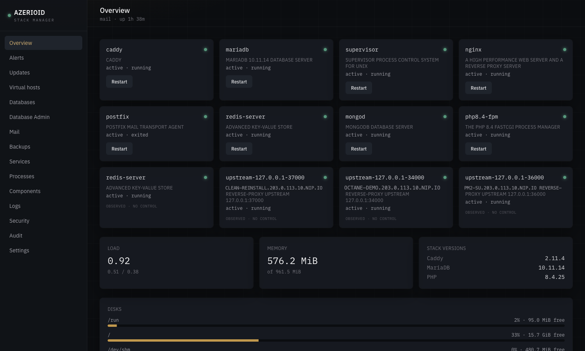
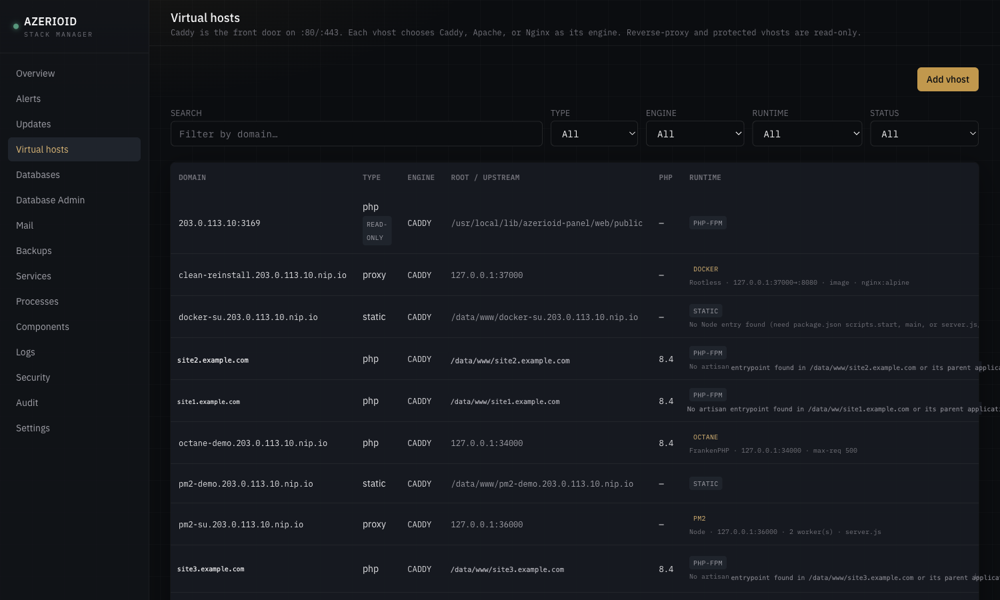
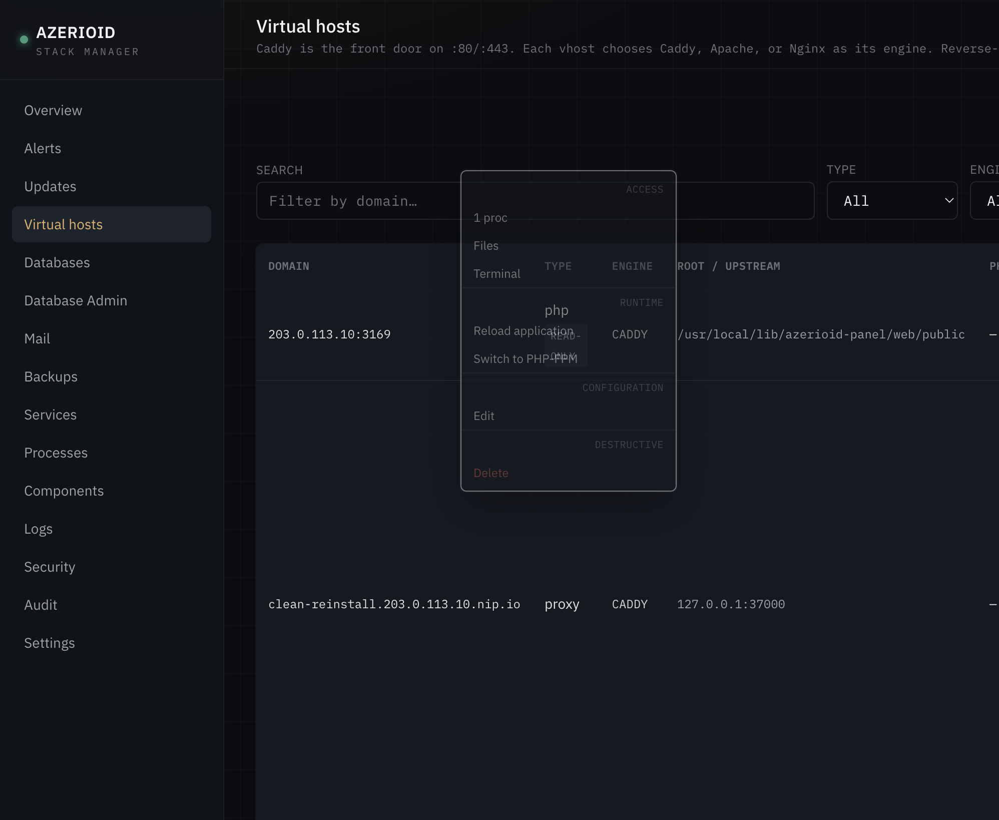
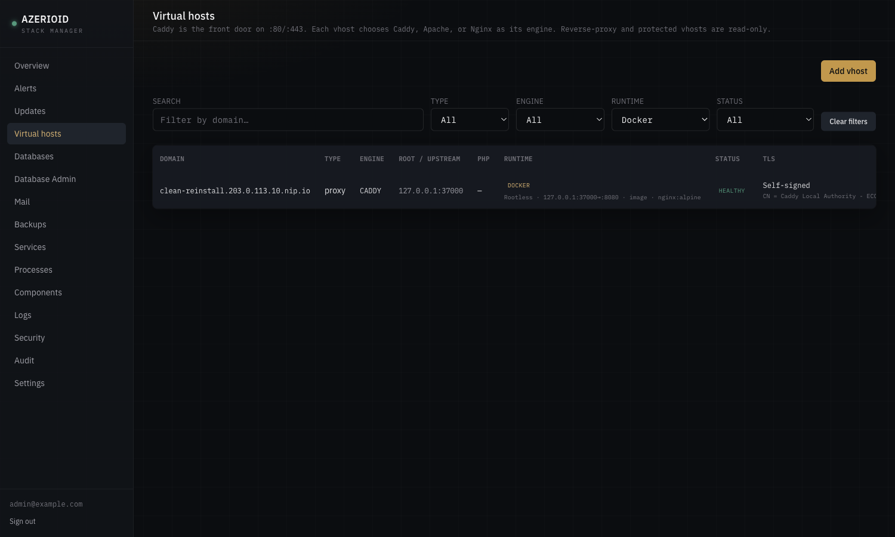
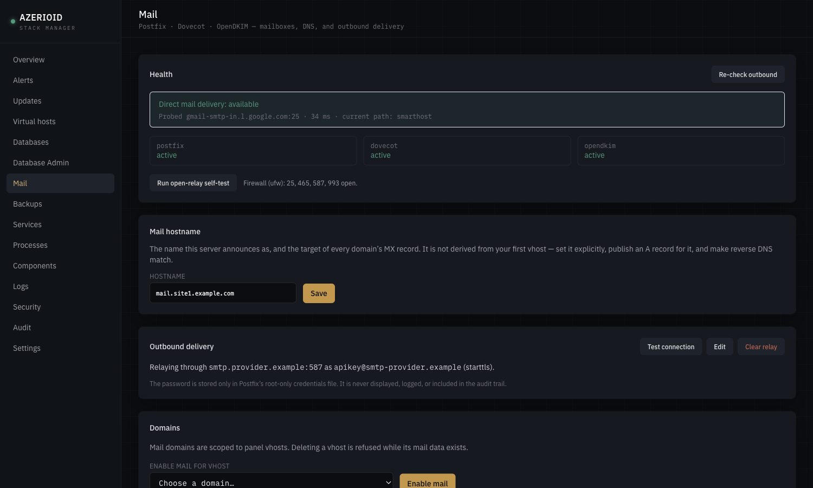
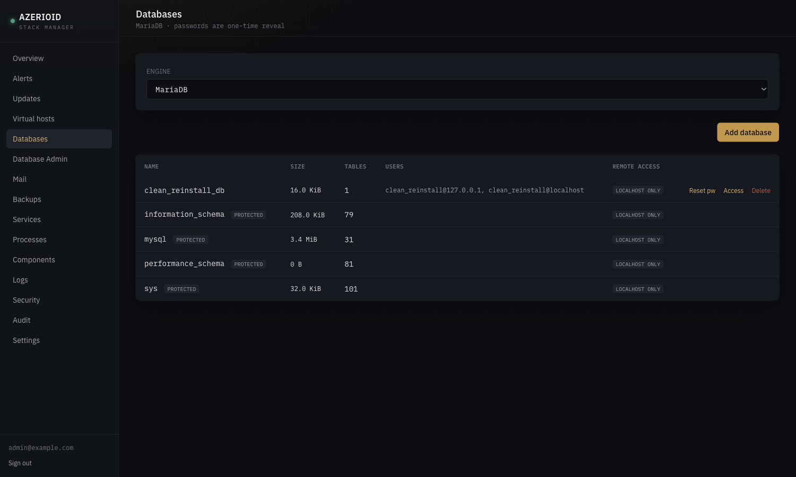
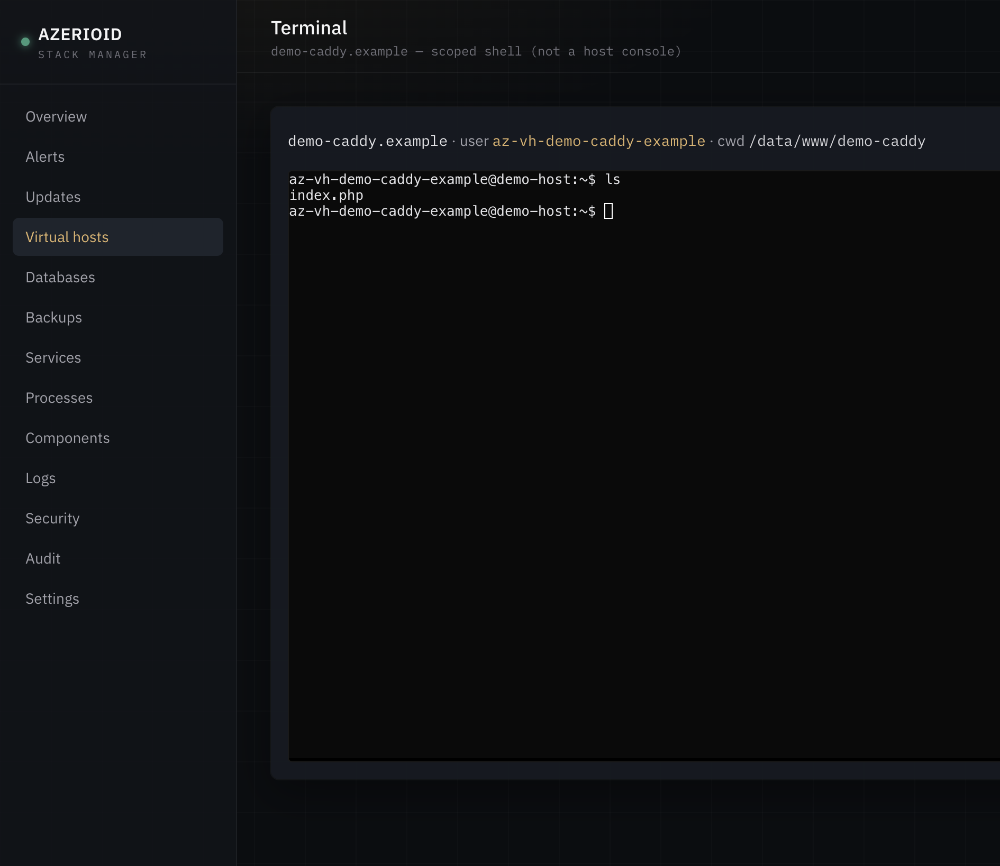
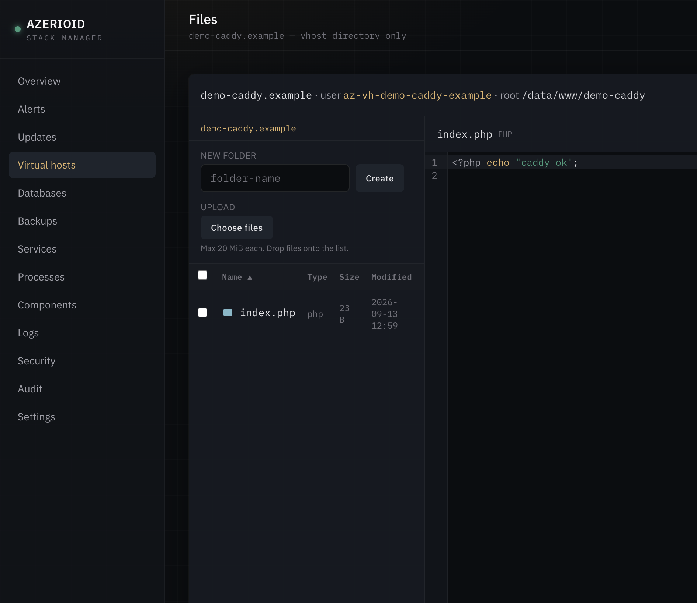
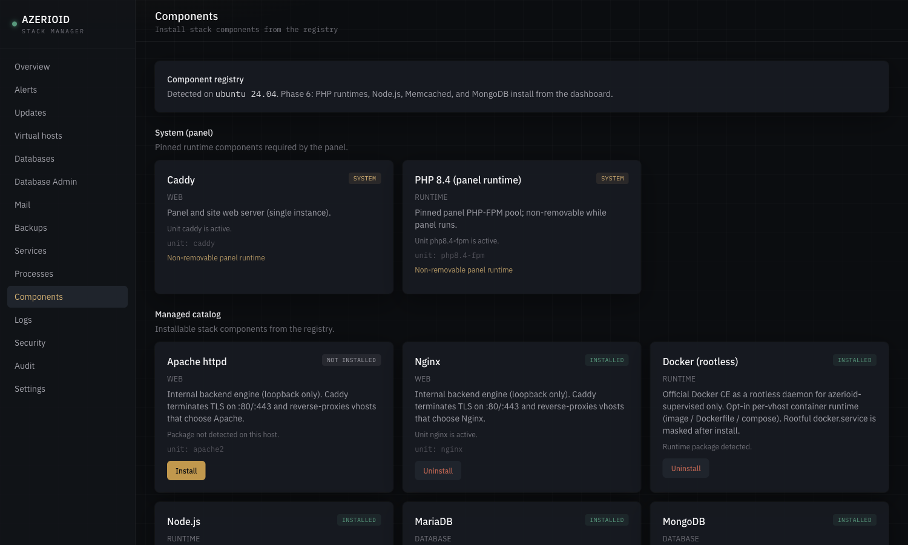
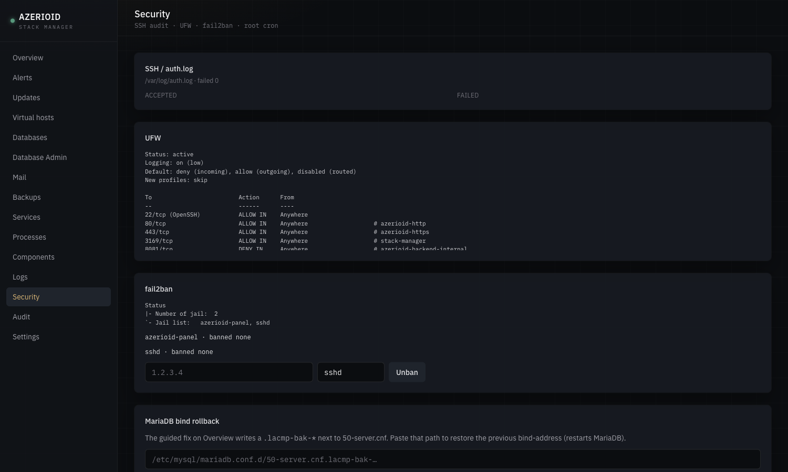

# AZERIOID Stack Manager

**One host. One panel. A Linux web stack you control.**

AZERIOID Stack Manager is a self-hosted control panel for running sites on a single Linux server. One
installer sets up **Caddy**, the panel's own **PHP 8.4** FPM service and a **SQLite**-backed admin UI on
**Laravel 13 + Livewire 4**. Everything else — Nginx, Apache, databases, caches, more PHP versions,
Node.js, Supervisor, mail, rootless Docker, Elasticsearch — is installed on demand from the dashboard or
the `azerioid` CLI.

The web UI never runs package managers or touches the host itself. Every privileged change goes through
a separate root **broker** that only accepts a fixed list of actions and re-validates every input. Each
site runs under its own Unix account.

## Star History

<a href="https://www.star-history.com/?repos=azerioid/azerioid-stack-manager&type=date&legend=top-left">
 <picture>
   <source media="(prefers-color-scheme: dark)" srcset="https://api.star-history.com/chart?repos=azerioid/azerioid-stack-manager&type=date&theme=dark&legend=top-left" />
   <source media="(prefers-color-scheme: light)" srcset="https://api.star-history.com/chart?repos=azerioid/azerioid-stack-manager&type=date&legend=top-left" />
   
 </picture>
</a>

## Screenshots

Captured from the maintainer's Ubuntu 24.04 test host. Domain names and the host's IP address were replaced
with documentation values (`example.com`, `203.0.113.x`). The screenshots predate some newer pages (Redis,
Firewall, Cron, SFTP) and show earlier wording in places, such as the Docker description on the Components
page.

| Overview | Virtual hosts |
|:---:|:---:|
|  |  |

| Virtual hosts · row actions | Docker runtime filter |
|:---:|:---:|
|  |  |

| Mail | Databases |
|:---:|:---:|
|  |  |

| Terminal | File Manager + editor |
|:---:|:---:|
|  |  |

| Components | Security |
|:---:|:---:|
|  |  |

## What the installer sets up vs what you add later

### Installed by the bootstrap

| Piece | Role |
|-------|------|
| **Caddy** | Panel listener on port **3169**; front door on `:80`/`:443` for every site |
| **PHP 8.4 FPM** | The panel's own php-fpm service, running as the dedicated `azerioid-panel` account |
| **SQLite** | Panel state under `/var/lib/azerioid-panel/` |
| **Broker** | Root helper reached through one sudoers entry that only `azerioid-panel` holds |
| **Queue worker + scheduler** | Background jobs (installs, backups, deploys) and periodic convergence checks |

### Installed on demand (Components page or `azerioid component install …`)

| Category | Components |
|----------|------------|
| **Web engines** | Nginx, Apache — bound to loopback behind Caddy, which terminates TLS |
| **Databases** | MariaDB, PostgreSQL, MongoDB |
| **Cache / search** | Redis (per-site users), Memcached (single-tenant, see limitations), Elasticsearch 9 |
| **Runtimes** | PHP 8.1–8.4 for sites (one FPM pool per site); Node.js 20 / 22 / 24 side by side, plus an optional system Node.js |
| **Process manager** | Supervisor |
| **Per-site app runtimes** | PHP-FPM (default), Laravel Octane on FrankenPHP, PM2 cluster for Node, rootless Docker (image, Dockerfile or compose) |
| **Mail** | Postfix + Dovecot + OpenDKIM: authenticated submission, virtual mailboxes, DKIM/SPF/DMARC records, direct or smarthost outbound |
| **Tools** | Adminer (MariaDB, PostgreSQL, SQLite; reachable only through the panel session) |

## Per-site isolation

Every site gets its own Unix account (`az-vh-<site>`) and its own group. Other sites' accounts are not
members of that group (the web server is, so it can serve the files), so site A's code cannot read site B's
files.

| Workload | Runs as |
|----------|---------|
| Site PHP | Its own PHP-FPM pool, under the site's account. The socket is reachable only by the web server |
| Laravel Octane | The site's account |
| PM2 | The site's account, with its own `PM2_HOME` |
| Supervisor program bound to a site | The site's account. Asking for any other account is refused |
| Supervisor program bound to no site | The shared `azerioid-supervised` account (never root) |
| Docker | One rootless Docker daemon per Docker site, run by the site's account, with its own subordinate ID range. Rootful `docker.service` is masked and there is no `docker` group |
| Terminal and File Manager | The site's account. The File Manager rejects paths outside the site; the terminal is a normal, non-chrooted shell limited by file permissions |
| SFTP | The site's account. Keys only, no shell, no forwarding, no chroot |
| Git deploy | Root fetches with a root-only deploy key; checkout and build steps run as the site's account |
| Cron jobs | The site's account. A root job needs a typed confirmation every time |
| Redis | A Redis ACL user per site, limited to keys and channels under its own prefix |
| Databases | One user per database. MariaDB grants cover only that database; PostgreSQL databases are closed to other roles |

Sites are moved onto this layout automatically when an older install updates, one at a time, with an HTTP
check after each move. A site that fails its check is put back on the shared pool or daemon and reported, not
retried. The shared `azerioid-supervised` account and the shared Docker daemon are still used for such
put-back sites and for programs bound to no site.

## Features

- **Virtual hosts on three engines** — each site picks Caddy, Apache or Nginx; Caddy always owns
  `:80`/`:443`. The runtime (PHP-FPM, Octane, PM2 or Docker) is chosen at creation or switched later.
- **HTTPS** — Let's Encrypt HTTP-01, DNS-01 through Cloudflare or DigitalOcean, or Caddy's internal CA.
- **Laravel Octane (FrankenPHP)** and **PM2 cluster mode** per site, managed by Supervisor behind Caddy,
  with reload commands. PM2 sites pick their Node.js major.
- **Rootless Docker** per site — pull an image, build a Dockerfile or run a compose project from the site
  tree; environment files, volumes, restart policy, private registries, container shell and logs.
- **Git deploy** — SSH deploy key, manual or scheduled (hourly/daily) deploys, code rollback, and an
  optional push webhook (GitHub `X-Hub-Signature-256` or GitLab token; the secret is shown once; a push to
  any other branch is ignored).
- **Site clone** — copy a site into a new, separate site with its own account, optionally with copies of its
  databases (each with a new user), and re-create its Octane/PM2 runtime where possible.
- **Per-site resource limits** — each runtime is capped with the mechanism it actually has (see
  [Known limitations](#known-limitations) for what is stored but not enforced).
- **Backups** — databases, site files and Caddy config; local or DigitalOcean Spaces; encrypted
  (AES-256-GCM, chunked); retention by count and age; verification, including an opt-in deep check that
  restores database dumps into a scratch database. **Site bundles** pack one site's files, config and
  databases with a SHA-256 manifest, with per-target schedules.
- **Mail (opt-in)** — mailboxes and aliases per domain, copy-paste MX/SPF/DKIM/DMARC records with live
  checks, an outbound port-25 probe, direct delivery or a smarthost. Replacing an existing MTA needs a typed
  `REPLACE-MTA`; deleting a site that has mail needs `DROP-MAIL`.
- **Databases** — create, clone, reset passwords; remote access per database (localhost, specific IPs, or
  global with confirmation). MongoDB remote access is instance-wide.
- **Redis page** — enable Redis per site and copy its `.env` lines; enforce per-site users when every site
  that uses Redis has its own.
- **Search page** — Elasticsearch 9, single node on loopback, password-protected.
- **File Manager** — edit, upload, copy, move, chmod, search, ZIP download, and ZIP extract behind zip-slip and
  symlink guards.
- **Terminal** per site in the browser.
- **SFTP** per site, keys only.
- **Cron page** — structured jobs per site, logs, run now, alert on failure.
- **Firewall page** — additive ufw/firewalld rules with an automatic revert window, plus fail2ban.
- **Processes** — Supervisor programs: create, start, stop, logs.
- **OS updates page** — security or all updates, reboot-required status, reboot.
- **PHP settings** — php.ini editor and OPcache statistics per PHP version.
- **Alerts** with Telegram notifications — service down, RAM/load/disk, reboot, TLS expiry and issuance,
  backup failed or stale, SSH failures and new root logins, app down (a crashed Octane/PM2/Docker worker), cron
  failures.
- **Audit log** — every privileged action from the UI and the CLI, filterable, with secrets redacted.
- **Per-site access logs** — tail or search a site's Caddy access log.
- **2FA** — optional or required TOTP, with one-time recovery codes.
- **CLI parity** — `azerioid` calls the same broker actions as the dashboard (logged as `origin=cli`).
- **Self-update from release tags** — `azerioid panel update check|apply` installs only tags on `main`,
  refuses a dirty source tree, deploys only the release you were shown, and rolls back if an update fails
  midway.
- **Panel domain** — serve the panel on a hostname on `:443`; IP:3169 and an SSH tunnel stay available.

## Supported operating systems

The installer accepts these and refuses everything else (Fedora, older or newer Ubuntu releases, other
distributions):

| OS | Versions |
|----|----------|
| Ubuntu | 24.04 |
| Debian | 12, 13 |
| AlmaLinux, Rocky Linux, CentOS Stream, RHEL, Oracle Linux | 9, 10 |

Every release is deployed to the maintainer's Ubuntu 24.04 host and checked with `deploy/verify-release.sh`; a
Rocky Linux 9 host with SELinux enforcing is used for EL testing. Other accepted versions get less
regular testing; release notes say what a release was tested on.

Requirements: root, outbound HTTPS, `git`.

## Quick start

```bash
git clone https://github.com/azerioid/azerioid-stack-manager.git stack-manager && cd stack-manager
chmod +x stack-manager.sh
sudo ./stack-manager.sh
```

**Interactive install** (TTY) asks for:

- Access mode — `tunnel` (default, `127.0.0.1:3169`) or `public` (HTTPS on the host IP)
- Panel port, optional TOTP requirement, firewall, fail2ban, IP allowlist
- Optional admin creation (email + password)

Non-interactive example:

```bash
sudo ./stack-manager.sh --non-interactive --access=public --create-admin=true --admin-email=you@example.com
# Set ADMIN_PASSWORD in the environment. There is no default: it needs 12+ characters with upper and
# lower case, a number and a symbol, or the install stops at the admin step (use /setup in the browser instead).
```

Tunnel access after a default install:

```bash
ssh -L 3169:127.0.0.1:3169 user@host
# open http://127.0.0.1:3169/setup  (or /login if an admin was created)
```

Other flags: `--firewall=true`, `--fail2ban=true`, `--require-totp=true`, `--domain=`, `--allowlist=`,
`--port=`, `--dry-run`. Full list: `sudo ./stack-manager.sh --help`.

## Security model

- **Privilege split.** The panel runs as `azerioid-panel`, the only account with the sudoers entry for the
  broker. The broker accepts a fixed list of actions and re-validates every input.
- **Per-site accounts.** Site code, workers, containers, terminals, SFTP, deploys and cron run as the
  site's own account (see [Per-site isolation](#per-site-isolation)), never as root.
- **Registry-gated installs.** Only components defined in `registry/components/` can be installed. Every
  third-party repository trusts only a signing key pinned by fingerprint, and no vendor setup script is
  piped into a shell. PM2 is installed from a lockfile shipped in this repository.
- **Rootless Docker only.** Rootful `docker.service`/`docker.socket` are masked and there is no `docker`
  group.
- **Loopback services.** Databases, caches and web engines listen on loopback. Loopback is not treated as a
  boundary between sites: Redis has per-site users, database grants are per database, Elasticsearch has a
  password. Memcached has no access control (see limitations).
- **Mail.** Not an open relay: `mynetworks` is localhost only and SASL is on submission ports only. There is
  an open-relay self-test.
- **Adminer** is reachable only through the panel's authenticated session.
- **Secrets are not command-line flags.** Passwords, DNS-01 tokens and relay credentials are never
  accepted as flags; you pass them through stdin, the environment or a prompt. The broker hands database
  admin passwords to engine clients on stdin or in the environment and keeps them in root-only files.
  Generated credentials are shown once where they have to be shown.
- **Hardening options.** Optional TOTP (with recovery codes), fail2ban, IP allowlist, ufw/firewalld rules.
- **Self-update** deploys only release tags on `main`.
- **Public endpoint.** The git deploy webhook is the one public, unauthenticated endpoint by design. It
  checks an HMAC signature, is throttled, and is not subject to the IP allowlist.

Design decisions and their reasoning: [`docs/DECISIONS.md`](docs/DECISIONS.md) (ADRs), [`docs/SPEC.md`](docs/SPEC.md),
[`docs/port-ownership.md`](docs/port-ownership.md). Reporting a vulnerability: [`SECURITY.md`](SECURITY.md).

## CLI examples

```bash
azerioid status
azerioid vhost list --json
azerioid vhost add --domain=app.example.com --type=php --php=8.4 --root=/data/www/app.example.com --tls=auto
azerioid vhost add --domain=api.example.com --type=php --php=8.4 --runtime=octane --tls=auto
azerioid vhost octane enable --domain=api.example.com
azerioid vhost octane reload --domain=api.example.com
azerioid vhost pm2 enable --domain=node.example.com --instances=2 --entry=server.js
azerioid vhost docker enable --domain=app.example.com --mode=image --image=nginx:alpine --internal-port=80
azerioid vhost clone --source=app.example.com --domain=staging.example.com --db=appdb:appdb_staging
azerioid vhost limits --domain=app.example.com --php-memory=256 --max-children=10
azerioid vhost limits --domain=box.example.com --memory=512 --cpu=150   # --cpu applies to Docker only
azerioid db add --engine=mariadb --name=appdb --user=appdb
azerioid db clone --engine=mariadb --source=appdb --name=appdb_staging
azerioid component install redis
azerioid component install mail   # refuses another MTA unless --option=confirm=REPLACE-MTA
azerioid process create --vhost=app.example.com --command='node server.js' --name=app-node
azerioid mail hostname set --hostname=mail.example.com
azerioid mail domain enable --domain=app.example.com
azerioid mail mailbox add --address=inbox@app.example.com   # password printed once
azerioid mail smarthost set --host=smtp.provider.example --port=587 --username=apikey
# relay password: AZERIOID_RELAY_PASSWORD=… in the environment (not a flag)
azerioid mail dns --domain=app.example.com
azerioid panel update check
azerioid panel update apply --confirm              # latest release
azerioid panel update apply --v=v2.15.7 --confirm  # a specific release
```

Further command groups: `backup`, `deploy`, `cron`, `sftp`, `firewall`, `search`, `updates`, `totp`,
`audit`, `service`. Redis per-site users are managed on the Redis page. Full surface: `azerioid help`.

## Known limitations

**General**

- One admin account. There are no roles or multiple users.
- Ubuntu 26.04 is not accepted yet.

**Sites and runtimes**

- Git deploys check out in place, not atomically, so a mix of old and new files can be served briefly.
  Rollback restores code only; database migrations are not undone.
- Resource caps:
  - PHP-FPM caps are per request (`memory_limit`) plus concurrency (`pm.max_children`), not a total cap.
  - PM2 has a restart-based memory cap and no CPU cap.
  - Octane caps and compose-mode Docker caps are stored but not enforced.
  - Docker caps need cgroup v2 delegation; without it they are recorded but not enforced.
- Site clone refuses Docker sites and cannot clone MongoDB databases. Clone and restore refuse trees over
  20 GB or 200,000 entries and sources containing setuid/setgid files.
- Docker compose host bind mounts are not scanned; they are bounded by the site's own account. Amazon ECR
  registries are not supported.
- SFTP has no chroot. The terminal is a normal shell limited by file permissions, not by path.
- Apache sites: `.htaccess` cannot use rewrite, redirect, handler or proxy directives (they are ignored). PHP
  sites route through `FallbackResource /index.php`; custom `RewriteRule`s belong in the vhost, not `.htaccess`.
- App upstreams (Octane, PM2, Docker) are loopback TCP ports. Another local account can bind one while the site's
  worker is down; the panel then refuses to start onto it and raises the `app.down` alert, but does not prevent it.

**Mail**

- No webmail, spam filtering, quotas or catch-all addresses.
- Messages are limited to 25 MiB.
- Only mail sent through submission (587/465) with a mailbox login is DKIM-signed. Local mail (PHP `mail()`,
  `sendmail`, loopback SMTP, the Mail page's test message) is relayed unsigned.
- A login sends only as its own addresses (envelope sender); the `From:` header is not checked against it.
- Deliverability depends on reverse DNS set at your provider; many providers block outbound port 25, in
  which case use a smarthost.

**Caches and search**

- On an existing install, Redis keeps answering clients without a password until you press **Enforce
  per-site users** on the Redis page. Every key must carry the site's prefix, and `php artisan cache:clear` on
  a Redis store fails because `FLUSHDB` is refused.
- Memcached has no access control: every site can read and change every item. Use it for one site or for
  data that is not private.
- Elasticsearch is single node and needs at least 2 GB of physical RAM. The low-memory override is for test
  hosts only.

**Backups**

- Site bundles restore to the same domain only and do not include TLS keys or mail.
- Backups made before v1.7.0 restore but cannot be verified as untampered.

**Web and updates**

- The catch-all page for hostnames no site claims is opt-in (`azerioid panel default-site`).
- A vendor signing-key rotation stops that repository from being added until the panel ships the new pin.

**Not yet exercised on a live host** (covered by tests only):

- the MongoDB backup engine against a real `mongodump`;
- MongoDB provisioning through the localhost exception;
- Redis per-site users on Redis 6.2 (EL9);
- site clone since v2.15.3;
- firewall rules on every OS family;
- a full Elasticsearch install on a host with 2 GB or more.

## Uninstall

Panel only:

```bash
sudo ./deploy/uninstall.sh --drop-db --remove-bootstrap
```

Full teardown — panel, broker-managed components, added repositories **and the database engines' data
directories**:

```bash
sudo ./deploy/uninstall.sh --full
```

`--full` **deletes every database on the host** (`/var/lib/mysql`, `/var/lib/mongodb`,
`/var/lib/pgsql`, `/var/lib/postgresql`). Back up first. It keeps site trees under `/data/www` and the logs
under `/var/log/azerioid-panel`. `sudo ./deploy/uninstall.sh --help` lists the individual flags.

## How this project is built

The code in this repository is written by an AI coding agent, **Claude Code** (Anthropic), working under
the maintainer's direction. The maintainer:

- **decides the design** — architecture and security decisions, recorded as ADRs in
  [`docs/DECISIONS.md`](docs/DECISIONS.md);
- **reads every diff** before it is merged;
- **tests on a live host** — releases are installed and exercised on the maintainer's own servers.

Every change also goes through the automated test suite and CI.

## License

MIT — see [`LICENSE`](LICENSE).

## Contributing

Issues and pull requests: [azerioid/azerioid-stack-manager](https://github.com/azerioid/azerioid-stack-manager).
Architecture decisions live in [`docs/DECISIONS.md`](docs/DECISIONS.md); keep ADR history intact when
proposing changes. Security issues: see [`SECURITY.md`](SECURITY.md), not the public tracker.
